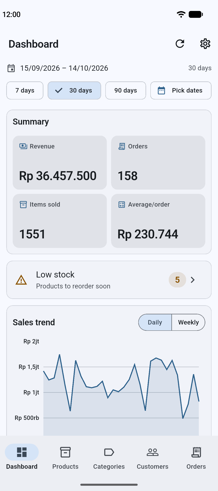
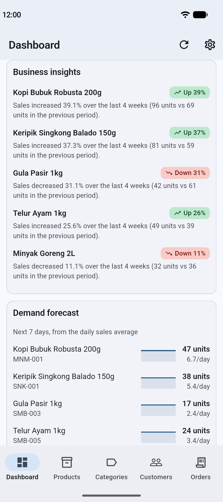
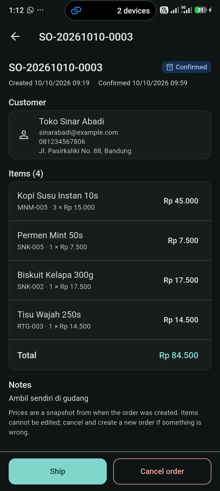
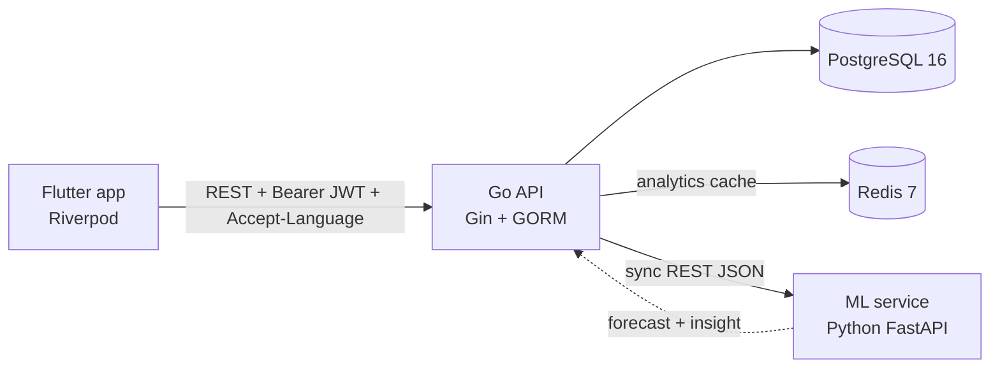

# Inventory & Sales Intelligence Platform

> **An inventory system that forecasts demand from historical sales.** It doesn't just record stock. It tells you which products are rising, which are falling, and roughly how many units will sell next week.

A mini-ERP for a wholesale distributor: products, stock, customers and sales orders are managed from a mobile app, and the sales data is turned into an analytics dashboard, demand forecasts and business insights in two languages. Every user logs in and can only do what their role allows; roles and their permissions are managed from inside the app.

🇮🇩 **Indonesian version:** [README.md](README.md) · 🎤 **Interview narrative (Indonesian):** [docs/PRESENTATION.md](docs/PRESENTATION.md)

---

## Screenshots

<!-- REPLACE with real screenshots. Save the PNGs under docs/screenshots/ with exactly these names.
     Suggested capture: Pixel_9_Pro_XL emulator, data from `go run ./cmd/seed`, 30-day range. -->

| Dashboard | Forecast & Insight | Order detail |
|---|---|---|
|  |  |  |

<!-- REPLACE with a real GIF (optional, ≤ 5 MB): stop the ML service → the Forecast section turns "unavailable" while the other sections stay filled. -->


---

## Architecture



- **The Go API** is the only service that touches the database: the source of truth for stock, orders, users and permissions.
- **The ML service** is stateless: it has no database access, and Go sends it the sales history in each request body. If it is down, the API keeps working and the dashboard shows an "unavailable" state, not a 500.
- **Redis** caches the dashboard aggregates (5 minutes) and forecast reports that were 100% successful (10 minutes). User permissions are deliberately **not** cached.

Architecture decisions and their reasons: [docs/architecture.md](docs/architecture.md). Go ↔ ML contract: [docs/ml-service-contract.md](docs/ml-service-contract.md).

## Tech Stack

| Layer | Technology |
|---|---|
| Backend | Go 1.26 (`go.mod`), Gin, GORM, PostgreSQL 16, Redis 7 (go-redis), golang-jwt (HS256), bcrypt |
| Mobile | Flutter (Dart `^3.13.2`), Riverpod 3 (codegen), go_router, Dio, freezed, fl_chart, flutter_secure_storage, ARB i18n |
| ML / Data | Python 3.12+, FastAPI, Pydantic v2, pandas |
| Infra | Docker Compose (Postgres + Redis), bash e2e script |

Why each choice (Go rather than Nest.js, Postgres rather than MySQL, and so on) is in [CLAUDE.md](CLAUDE.md) and [docs/architecture.md §3](docs/architecture.md).

## Main Features

- **Product & category catalogue** — CRUD with search + pagination; a category still used by products can't be deleted (409) instead of leaving orphaned data.
- **Inventory with an audit trail** — every stock change is an immutable `stock_movement` (IN / OUT / ADJUSTMENT) written in one transaction under a row lock (`SELECT … FOR UPDATE`). Stock can't go negative, guarded twice: service validation + a `CHECK` constraint in the DB.
- **Automatic low-stock detection** — a threshold per product with a global default; a badge on the dashboard and its own page.
- **Sales orders with a state machine** — `PENDING → CONFIRMED → SHIPPED`, or `→ CANCELLED`. Stock is deducted on confirm and returned when a confirmed order is cancelled. Every item is locked in `product_id` order to prevent deadlocks; one short item → the whole order rolls back with an error per item. Prices are snapshotted when the order is created.
- **Concurrency-safe, and proven** — the e2e script runs 5 parallel orders racing for the same stock (exactly 3 succeed), 1 order confirmed 10× in parallel (stock deducted once), 20 parallel creates (unique, gapless order numbers), and 20 parallel stock OUTs.
- **Analytics dashboard** — revenue summary, daily/weekly trend (no missing dates, via `generate_series`), top products, breakdown per category. All aggregated by Postgres straight from the order tables; only CONFIRMED/SHIPPED orders count. Cached in Redis.
- **Demand forecasting** — a moving average per product (7-day window, horizon up to 90 days) in Python, behind a `Forecaster` protocol so the model can be swapped without changing the API contract. Go calls it in parallel (8 at most) after building every product's history in **one** SQL query.
- **Business insights** — ready-to-read sentences such as *"Sales increased 61.9% over the last 4 weeks (102 units vs 63 units in the previous period)."* — computed statistically, deterministic and testable.
- **Graceful degradation** — one product fails to forecast → only that row carries an `error`; the ML service is down entirely → still HTTP 200 with `forecast_available: false`, and the app shows a calm state that is distinct from an error.
- **Login & sessions** — JWT access token (15 minutes) + refresh token (7 days). Refresh tokens are stored as SHA-256 hashes and **rotated** on every use; an old token used again (reuse) revokes every session of that user. In the app, tokens live in the Keychain/Keystore, and many simultaneous 401s trigger a single refresh.
- **Per-resource-action RBAC** — 32 permissions shaped `<resource>.<action>` (e.g. `products.delete`, `sales_orders.confirm`), checked on every route against the database with no cache, so a permission change applies on the next request. Built-in roles **Super Admin** (passes every check) and **Staff** (12 permissions); further roles are created and given permissions by a Super Admin from **Settings → Administration** in the app. The app shows only what is allowed: tabs and Dashboard sections follow the `*.view` permissions (a role with no view permission at all gets a "nothing to show yet" screen), and actions a user isn't allowed to take are hidden. Permissions are re-read when the app returns to the foreground and after the server answers 403, so a Super Admin's change shows up without logging in again.
- **Privilege-escalation guard** — a non-Super-Admin can only grant permissions or roles whose permissions they hold themselves, and can only change/delete users whose role they hold in full. The app mirrors the same rule: the role picker offers only roles that may be given, and users beyond the caller's permissions show as locked. At least one active Super Admin always remains, guarded by a lock.
- **Bilingual end to end** — Indonesian/English via `Accept-Language`, covering app labels (380 ARB keys), validation & error messages from Go, and the insight sentences from the ML service.
- **Mobile polish** — dark mode, 6 accent colours, skeleton loading, motion that respects the *reduce motion* setting, and automated WCAG AA contrast tests.

## Quick Start

Requirements: Docker + Compose v2, Go 1.26+, Python 3.12+, Flutter 3.47+. Every step starts from the repo root. All commands below use bash (on Windows: Git Bash); PowerShell equivalents are in each service's README.

**1. Infra — Postgres + Redis** ([infra/README.md](infra/README.md))

```bash
cd infra
cp .env.example .env          # change at least POSTGRES_PASSWORD and REDIS_PASSWORD
docker compose up -d
docker compose ps             # wait for both services (healthy)
```

**2. Backend — migrations + accounts + demo data** ([backend/README.md](backend/README.md))

```bash
cd backend
cp .env.example .env          # match DATABASE_URL / REDIS_* to infra/.env, set JWT_SECRET
go run ./cmd/migrate
go run ./cmd/seed --clean     # remove test/demo leftovers — explicit, never automatic
go run ./cmd/seed             # accounts + roles, 5 categories, 26 products, 10 customers, ~430 orders over 75 days
```

**3. ML service** ([ml-service/README.md](ml-service/README.md)) — new terminal

```bash
cd ml-service
python -m venv .venv
source .venv/Scripts/activate      # Linux/macOS: source .venv/bin/activate
pip install -r requirements-dev.txt
uvicorn app.main:app --reload --port 8000
```

**4. Go API** — new terminal

```bash
cd backend
go run ./cmd/api                    # another port: PORT=8090 go run ./cmd/api
curl http://localhost:8080/health   # {"status":"ok","checks":{"database":"up","redis":"up"}}
```

**5. Mobile** ([mobile/README.md](mobile/README.md))

```bash
cd mobile
flutter pub get
flutter run --dart-define=API_BASE_URL=http://10.0.2.2:8080   # Android emulator
```

`10.0.2.2` is the host machine as seen from the Android emulator. For the iOS simulator/desktop, plain `flutter run` is enough (default `http://localhost:8080`); for a physical device, use the host's LAN IP. The app opens on the login screen.

> The ML service is optional: without it everything works except two sections (Demand Forecast & Business Insights), which show an "unavailable" state.

## Demo Accounts

Created by `go run ./cmd/seed` (and by `--auth-only`), from [`backend/cmd/seed/accounts.go`](backend/cmd/seed/accounts.go):

| Account | Password | Role |
|---|---|---|
| `admin@example.com` | `admin12345` | **Super Admin** — every permission. The email/password can be changed with `SEED_ADMIN_EMAIL` / `SEED_ADMIN_PASSWORD` in `backend/.env` |
| `staff@example.com` | `staff12345` | **Staff** — sees all data, creates and processes orders; can't delete, edit the catalogue/stock, or manage users and roles |

The seeder never resets the password of an existing account. Change both passwords anywhere other than a local demo.

## RBAC Demo

An interviewer can run this in the app (labels below are the English ones; the app's language can be changed in Settings). Settings is not a tab: it opens from the ⚙ icon in every tab's app bar.

**A. A Super Admin creates a role and a user**

1. Log in as `admin@example.com`. Open **Settings → Administration → Roles & permissions** and add a role **Gudang** (warehouse).
2. On that role's page, **Edit permissions**: tick `products.view`, `inventory.view`, `inventory.record_movement`, and save.
3. **Settings → Administration → Users**: add the user `gudang@example.com` (password at least 8 characters) with the role Gudang.

**B. Log in as that user and watch the UI change**

4. **Sign out**, log in as `gudang@example.com`.
5. The app opens straight on **Products**, the only tab allowed, so there is no bottom bar. Dashboard, Categories, Customers and Orders don't appear; a deep link to them also lands back on Products.
6. The product list has no add button and no swipe-to-delete. A product's detail shows the stock and a **Record movement** button, but no edit button.
7. **Settings** (the ⚙ icon) has no Administration section.

**C. A user manager and the "only what you hold" rule**

8. As the Super Admin, create a role **User Manager** with `users.view`, `users.create`, `users.update`, **plus every permission of the Gudang role** (`products.view`, `inventory.view`, `inventory.record_movement`). Create a user with this role and log in as them.
9. **Settings → Administration** only has **Users** (no Roles & permissions). Add a user: the role picker offers only **Gudang** (and any other role whose permissions the manager all holds). **Staff** and **Super Admin** don't appear, because Staff has order and analytics permissions this manager doesn't hold. Save with Gudang → it works.
10. In the user list, `staff@example.com` and the Super Admin account show as **locked** (a lock icon, "Beyond your permissions"): no swipe-to-delete, and a tap only shows that note. This is what stops "reset a stronger account's password, then log in as it".
11. The server remains the last line: a request that goes around the app (e.g. straight to the API) is refused with 403 and an already translated sentence, e.g. *"you can't assign the "Staff" role because it has the "categories.view" permission, which you don't hold yourself"*.

Note: a user manager holding **only** `users.*` can't create a Staff user — not even a Gudang user — because the role being given must be a subset of their permissions. That is why step 8 gives the manager the Gudang permissions as well.

**D. Change permissions without logging in again**

12. Keep the app logged in as `gudang@example.com`. From a Super Admin account on another device (or through the API), add `categories.view` to the Gudang role.
13. Send the Gudang app to the background and open it again: a bottom bar appears with **Products** and **Categories**. Take the permission away while the app shows Categories and repeat (more than 60 seconds after the first time): the app moves to Products and the Categories tab is gone.

The server applies a permission change on the next request (permissions aren't cached). The app re-reads `GET /auth/me` when it returns to the foreground (at most once per 60 seconds) and once after a 403 from a business endpoint.

This behaviour is locked in by tests: `TestUserService_PrivilegeMatrix` (60 cases: Super Admin / a manager with enough permissions / a manager with only `users.*` × 4 roles × create, assign role, reset password, deactivate, delete) and the *Guardrail* sections of `backend/scripts/e2e.sh`.

## Testing

| Suite | Command | Result (measured 2026-10-09) |
|---|---|---|
| Go | `cd backend && go test ./... -count=1` | **804 passed**, 0 failed; 15 SQL tests skipped without `TEST_DATABASE_URL` |
| Go + SQL against a real Postgres | `TEST_DATABASE_URL=... go test ./... -count=1` | **831 passed** (115 test functions + table-driven subtests), 0 failed, 0 skipped |
| Python | `cd ml-service && pytest` | **80 passed** |
| Flutter | `cd mobile && flutter test` | **702 passed** |
| End-to-end HTTP | `cd backend && bash scripts/e2e.sh` | **317/317** with the ML service up, **309/309** with it down |

`e2e.sh` needs Postgres, the migrations, the seeded accounts and a running API (`API_URL=http://localhost:8090/api/v1` if the API is on another port; `ADMIN_EMAIL` / `ADMIN_PASSWORD` if the admin credentials were changed). It switches to the degradation checks when the ML service doesn't answer, so run it twice (ML up and down) to cover both paths. At the end of a run, the users and roles it created are deleted for good (`go run ./cmd/seed --clean-e2e-run=<run>`); its test products, categories, customers and orders stay behind (soft delete), so run `go run ./cmd/seed --clean && go run ./cmd/seed` again before a demo.

Every number in the table comes from running the suites on 2026-10-09 (e2e: API on port 8090, Postgres + Redis from docker-compose).

## Repo Structure

```
backend/      Go API — handler → service → repository, cmd/{api,migrate,seed}, scripts/e2e.sh
ml-service/   FastAPI — forecasting + trend insight, stateless
mobile/       Flutter — clean architecture per feature (data / domain / presentation)
infra/        docker-compose for Postgres + Redis
docs/         architecture.md, ml-service-contract.md, PRESENTATION.md
```

The Go API has 48 endpoints (47 under `/api/v1` + `/health`), the ML service 3. The full endpoint → permission table is in [backend/README.md](backend/README.md#endpoints). Each service's layout is in its own README; decisions and project status are in [docs/architecture.md](docs/architecture.md).

## Known Limitations

- **Parts of a screen that read another resource aren't gated per permission yet.** Tabs and Dashboard sections follow the `*.view` permissions, but some parts inside screens don't: the customer and product pickers in the order form (`customers.view` / `products.view`), the category dropdown in the product form (`categories.view`), and the stock and movement history in a product's detail (`inventory.view`). A role without those permissions sees the server's 403 message there. The data itself stays protected by the backend.
- **Permission changes reach the app with a short delay**: when it returns to the foreground (at most once per 60 seconds) or after it gets a 403, not instantly (the server doesn't push).
- **No change-own-password endpoint yet**, and expired/revoked `refresh_tokens` rows aren't cleaned up periodically.
- **One role per user**, deliberately, as a simplification.
- No CI pipeline yet, and the ML service isn't in docker-compose (it runs manually; its Dockerfile exists).
- The forecast is a moving average that doesn't capture seasonality; insights are statistical templates, not an LLM; the dashboard cache isn't invalidated by new orders (it can lag up to 5 minutes); forecasting calls the ML service once per product. The data is synthetic.

**`user_count` is not a bug.** The per-role user count from the API counts **every** user that points at the role, including inactive and deleted (soft-deleted) ones. A deleted user keeps its `role_id` as history, and the foreign key `users.role_id` is `ON DELETE RESTRICT`, so the database refuses to delete the role while such a row exists. With this definition, `user_count > 0` means exactly that `DELETE /roles/:id` will answer 409. Details: [backend/README.md](backend/README.md#user_count).

The full discussion is in [docs/PRESENTATION.md](docs/PRESENTATION.md#5-keterbatasan-yang-disadari) (Indonesian).
