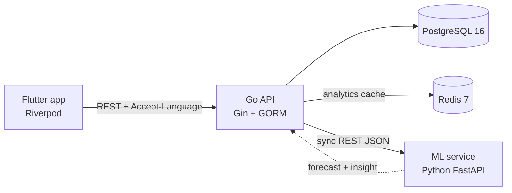

# Inventory & Sales Intelligence Platform

> **An inventory system that forecasts demand from historical sales.** It doesn't just record stock. It tells you which products are rising, which are falling, and roughly how many units will sell next week.

A mini-ERP for a wholesale distributor. A Flutter mobile app manages products, stock, customers and sales orders. A Go API owns the data. A Python service turns the sales history into demand forecasts and plain-language trend insights, in Indonesian or English.

🇮🇩 Full documentation (Indonesian): [README.md](README.md)

<!-- REPLACE with real screenshots saved under docs/screenshots/ (same file names as README.md). -->


## Architecture



- Only the Go API touches the database. It is the source of truth for stock and orders.
- The ML service is stateless. It has no database access, and Go sends it the sales history in each request body. If it is down, the API still answers 200 with `forecast_available: false`, and the app shows a calm "unavailable" state instead of an error.
- Details: [docs/architecture.md](docs/architecture.md) · Go ↔ ML contract: [docs/ml-service-contract.md](docs/ml-service-contract.md)

## Stack

| Layer | Technology |
|---|---|
| Backend | Go, Gin, GORM, PostgreSQL 16, Redis 7 |
| Mobile | Flutter, Riverpod 3, go_router, Dio, freezed, fl_chart |
| ML / Data | Python 3.12+, FastAPI, Pydantic v2, pandas |
| Infra | Docker Compose (Postgres + Redis) |

## Highlights

- **Stock with an audit trail.** Every change is an immutable stock movement. It is written in one transaction under a row lock (`SELECT … FOR UPDATE`). Stock can never go negative: the service validates it and a DB `CHECK` enforces it.
- **Sales order state machine** (`PENDING → CONFIRMED → SHIPPED`, or `→ CANCELLED`). Confirming deducts stock and cancelling a confirmed order returns it. Inventory rows are locked in `product_id` order to avoid deadlocks. If one item is short, the whole order rolls back with an error for each item.
- **Concurrency is tested, not just claimed.** 5 parallel orders race for the same stock and exactly 3 succeed. One order confirmed 10× in parallel deducts stock once. 20 parallel creates get unique, gapless order numbers.
- **SQL-native analytics.** Revenue, daily/weekly trend, top products and category breakdown are aggregated by Postgres straight from the order tables and cached in Redis.
- **Demand forecasting and trend insights.** A moving average sits behind a swappable `Forecaster` protocol. Go calls the ML service in parallel (8 at most) after building every product's history in a single SQL query.
- **Graceful degradation** per product and for the whole service.
- **Bilingual end to end** via `Accept-Language`: app labels (267 ARB keys), API validation messages and ML-generated insight sentences.

## Quick start

Requires Docker, Go 1.26+, Python 3.12+ and Flutter 3.47+. Run in bash (Git Bash on Windows). Each step is explained in the service READMEs.

```bash
# 1. Infra
cd infra && cp .env.example .env        # set POSTGRES_PASSWORD, REDIS_PASSWORD
docker compose up -d

# 2. Backend: schema + demo data
cd ../backend && cp .env.example .env   # match DATABASE_URL / REDIS_* to infra/.env
go run ./cmd/migrate
go run ./cmd/seed --clean
go run ./cmd/seed

# 3. ML service (new terminal, from the repo root — same for steps 4 and 5)
cd ml-service && python -m venv .venv && source .venv/Scripts/activate
pip install -r requirements-dev.txt
uvicorn app.main:app --reload --port 8000

# 4. Go API (new terminal)
cd backend && go run ./cmd/api

# 5. Mobile (Android emulator; 10.0.2.2 is the host machine)
cd mobile && flutter pub get
flutter run --dart-define=API_BASE_URL=http://10.0.2.2:8080
```

## Tests

| Suite | Command | Result |
|---|---|---|
| Go | `go test ./...` | 333 passed (52 test functions + table-driven subtests) |
| Python | `pytest` | 80 passed |
| Flutter | `flutter test` | 442 passed |
| E2E (real API) | `bash scripts/e2e.sh` | 159/159 on the last recorded run |

Service READMEs: [backend](backend/README.md) · [ml-service](ml-service/README.md) · [mobile](mobile/README.md) · [infra](infra/README.md)

## Known limitations

The project has no authentication and no CI pipeline yet. The ML service is not in docker-compose yet. The moving average does not capture seasonality. See [docs/PRESENTATION.md](docs/PRESENTATION.md#4-keterbatasan-yang-disadari) (Indonesian).
