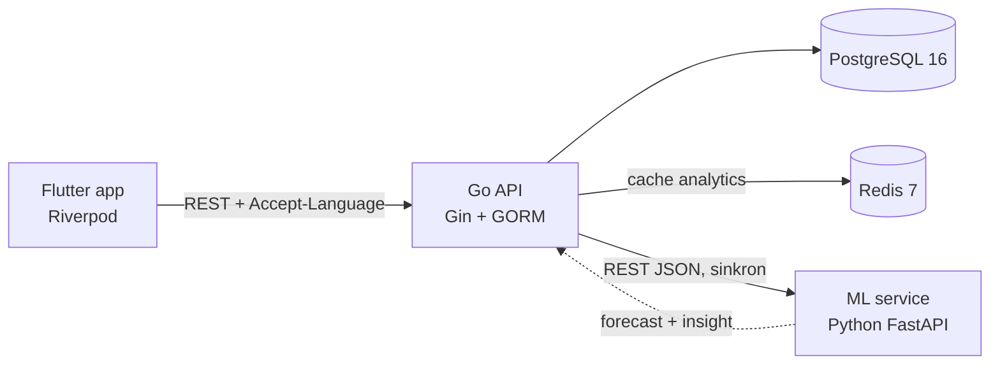

# Inventory & Sales Intelligence Platform

> **Sistem inventory yang memprediksi permintaan dari data penjualan historis** — bukan sekadar mencatat stok, tapi memberi tahu produk mana yang sedang naik, mana yang turun, dan berapa yang kemungkinan terjual minggu depan.

Mini-ERP untuk distributor/grosir: produk, stok, pelanggan, dan sales order dikelola lewat aplikasi mobile, lalu data penjualannya diolah menjadi dashboard analytics, demand forecast, dan insight bisnis dalam dua bahasa.

🇬🇧 **English version:** [README.en.md](README.en.md) · 🎤 **Narasi interview:** [docs/PRESENTATION.md](docs/PRESENTATION.md)

---

## Tampilan

<!-- GANTI dengan screenshot asli. Simpan file PNG di docs/screenshots/ dengan nama persis seperti di bawah.
     Saran pengambilan: emulator Pixel_9_Pro_XL, data dari `go run ./cmd/seed`, rentang 30 hari. -->

| Dashboard | Prediksi & Insight | Detail Pesanan |
|---|---|---|
|  |  |  |

<!-- GANTI dengan GIF asli (opsional, ≤ 5 MB): rekam ML service dimatikan → section Prediksi berubah ke state "tidak tersedia" sementara section lain tetap terisi. -->


---

## Arsitektur



- **Go API** adalah satu-satunya service yang menyentuh database — sumber kebenaran untuk stok dan order.
- **ML service** stateless: tidak punya akses DB, menerima history penjualan di request body dari Go. Kalau mati, API tetap jalan dan dashboard menampilkan state "tidak tersedia" — bukan error 500.
- **Redis** meng-cache agregasi dashboard (5 menit) dan laporan forecast yang 100% sukses (10 menit).

Detail keputusan arsitektur dan alasannya: [docs/architecture.md](docs/architecture.md). Kontrak Go ↔ ML: [docs/ml-service-contract.md](docs/ml-service-contract.md).

## Tech Stack

| Layer | Teknologi |
|---|---|
| Backend | Go, Gin, GORM, PostgreSQL 16, Redis 7 (go-redis) |
| Mobile | Flutter, Riverpod 3 (codegen), go_router, Dio, freezed, fl_chart, ARB i18n |
| ML / Data | Python 3.12+, FastAPI, Pydantic v2, pandas |
| Infra | Docker Compose (Postgres + Redis), bash e2e script |

Alasan tiap pilihan (kenapa Go bukan Nest.js, Postgres bukan MySQL, dst.) ada di [CLAUDE.md](CLAUDE.md) dan [docs/architecture.md §3](docs/architecture.md).

## Fitur Utama

- **Katalog produk & kategori** — CRUD dengan search + pagination; kategori yang masih dipakai produk ditolak dihapus (409), bukan dibiarkan jadi data yatim.
- **Inventory dengan audit trail** — setiap perubahan stok adalah `stock_movement` immutable (IN / OUT / ADJUSTMENT) yang ditulis dalam satu transaksi dengan row lock (`SELECT … FOR UPDATE`). Stok tidak bisa negatif, dijaga di dua lapis: validasi service + `CHECK` constraint di DB.
- **Deteksi low-stock otomatis** — threshold per produk dengan default global; badge di dashboard dan halaman khusus.
- **Sales order dengan state machine** — `PENDING → CONFIRMED → SHIPPED`, atau `→ CANCELLED`. Stok dikurangi saat confirm dan dikembalikan saat confirmed order dibatalkan. Semua item di-lock urut `product_id` untuk mencegah deadlock; satu item kurang stok → seluruh order di-rollback dengan error per item. Harga di-snapshot saat order dibuat.
- **Aman terhadap konkurensi, dan dibuktikan** — e2e menguji 5 order paralel yang berebut stok yang sama (tepat 3 sukses), 1 order di-confirm 10× paralel (stok berkurang sekali), 20 create paralel (nomor order unik tanpa celah), dan 20 stock-OUT paralel.
- **Dashboard analytics** — ringkasan pendapatan, tren harian/mingguan (tanpa celah tanggal lewat `generate_series`), produk terlaris, breakdown per kategori. Semua diagregasi langsung oleh Postgres dari tabel order; hanya order CONFIRMED/SHIPPED yang dihitung. Di-cache di Redis.
- **Demand forecasting** — moving average per produk (window 7 hari, horizon sampai 90 hari) di Python, di balik `Forecaster` protocol sehingga model bisa diganti tanpa mengubah kontrak API. Go memanggilnya paralel (maksimal 8 sekaligus) setelah menyusun history semua produk dalam **satu** query SQL.
- **Insight bisnis** — kalimat siap baca seperti *"Penjualan naik 61,9% dalam 4 minggu terakhir (102 unit vs 63 unit periode sebelumnya)."* — dihitung secara statistik, deterministik, dan bisa di-test.
- **Graceful degradation** — satu produk gagal di-forecast → hanya baris itu yang membawa `error`; ML service mati total → tetap HTTP 200 dengan `forecast_available: false`, dan app menampilkan state tenang yang berbeda dari error.
- **Dua bahasa end-to-end** — Indonesia/English lewat `Accept-Language`, mencakup label app (267 key ARB), pesan validasi & error dari Go, sampai kalimat insight dari ML service.
- **Polish mobile** — dark mode, 6 pilihan accent color, skeleton loading, motion yang menghormati setting *reduce motion*, dan test kontras WCAG AA otomatis.

## Quick Start

Prasyarat: Docker + Compose v2, Go 1.26+, Python 3.12+, Flutter 3.47+. Setiap langkah dimulai dari root repo. Semua perintah di bawah memakai bash (di Windows: Git Bash); padanan PowerShell ada di README tiap service.

**1. Infra — Postgres + Redis** ([infra/README.md](infra/README.md))

```bash
cd infra
cp .env.example .env          # ubah minimal POSTGRES_PASSWORD dan REDIS_PASSWORD
docker compose up -d
docker compose ps             # tunggu kedua service (healthy)
```

**2. Backend — migrasi + data demo** ([backend/README.md](backend/README.md))

```bash
cd backend
cp .env.example .env          # samakan DATABASE_URL / REDIS_* dengan infra/.env
go run ./cmd/migrate
go run ./cmd/seed --clean     # hapus sisa data test/demo — eksplisit, tidak pernah otomatis
go run ./cmd/seed             # 5 kategori, 26 produk, 10 pelanggan, ~430 order selama 75 hari
```

**3. ML service** ([ml-service/README.md](ml-service/README.md)) — terminal baru

```bash
cd ml-service
python -m venv .venv
source .venv/Scripts/activate      # Linux/macOS: source .venv/bin/activate
pip install -r requirements-dev.txt
uvicorn app.main:app --reload --port 8000
```

**4. Go API** — terminal baru

```bash
cd backend
go run ./cmd/api
curl http://localhost:8080/health   # {"status":"ok","checks":{"database":"up","redis":"up"}}
```

**5. Mobile** ([mobile/README.md](mobile/README.md))

```bash
cd mobile
flutter pub get
flutter run --dart-define=API_BASE_URL=http://10.0.2.2:8080   # Android emulator
```

`10.0.2.2` adalah alamat host dari dalam emulator Android. Untuk iOS simulator/desktop, cukup `flutter run` (default `http://localhost:8080`); untuk device fisik, pakai IP LAN host.

> ML service opsional: tanpa dia, semua fitur jalan normal kecuali dua section (Prediksi Permintaan & Insight Bisnis), yang akan menampilkan state "tidak tersedia".

## Testing

| Suite | Perintah | Hasil terakhir |
|---|---|---|
| Go unit test | `cd backend && go test ./...` | **333 lulus** (52 fungsi test + subtest table-driven), 0 gagal |
| Go SQL test ke Postgres asli | `TEST_DATABASE_URL=... go test ./internal/repository -run Analytics -v` | 7 test, di-skip kalau `TEST_DATABASE_URL` tidak di-set |
| Python | `cd ml-service && pytest` | **80 lulus** |
| Flutter | `cd mobile && flutter test` | **442 lulus** |
| End-to-end HTTP | `cd backend && bash scripts/e2e.sh` | **159/159** pada run terakhir yang tercatat |

`e2e.sh` butuh Postgres, migrasi, dan API yang sedang jalan. Script ini otomatis beralih ke pengecekan degradasi kalau ML service tidak menjawab, jadi jalankan dua kali (ML hidup dan mati) untuk menguji kedua jalur. Script menambah data test ke database — jalankan `go run ./cmd/seed --clean && go run ./cmd/seed` lagi sebelum demo.

Angka unit test di atas diambil dari eksekusi suite pada 2026-09-23; angka e2e dari log milestone di [docs/architecture.md](docs/architecture.md).

## Struktur Repo

```
backend/      Go API — handler → service → repository, cmd/{api,migrate,seed}, scripts/e2e.sh
ml-service/   FastAPI — forecasting + trend insight, stateless
mobile/       Flutter — clean architecture per fitur (data / domain / presentation)
infra/        docker-compose untuk Postgres + Redis
docs/         architecture.md, ml-service-contract.md, PRESENTATION.md
```

Detail layout tiap service ada di README masing-masing; keputusan dan status project di [docs/architecture.md](docs/architecture.md).

## Keterbatasan yang Diketahui

Belum ada autentikasi, belum ada pipeline CI, dan ML service belum masuk ke docker-compose (dijalankan manual). Forecast memakai moving average yang tidak menangkap pola musiman. Pembahasan lengkapnya ada di [docs/PRESENTATION.md](docs/PRESENTATION.md#4-keterbatasan-yang-disadari).
