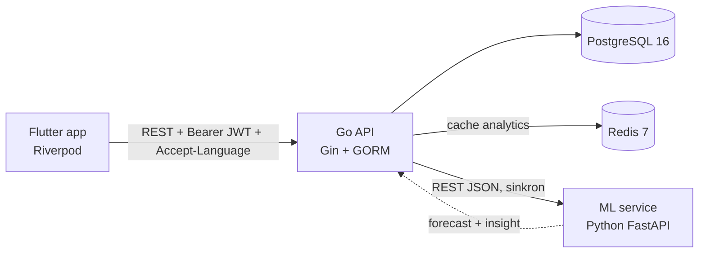

[](https://github.com/dannyalfandi/AI-Powered-Inventory-Sales-Intelligence-System/actions/workflows/ci.yml) [](https://github.com/dannyalfandi/AI-Powered-Inventory-Sales-Intelligence-System/actions/workflows/e2e.yml)

# Inventory & Sales Intelligence Platform

> **Sistem inventory yang memprediksi permintaan dari data penjualan historis** — bukan sekadar mencatat stok, tapi memberi tahu produk mana yang sedang naik, mana yang turun, dan berapa yang kemungkinan terjual minggu depan.

Mini-ERP untuk distributor/grosir: produk, stok, pelanggan, dan sales order dikelola lewat aplikasi mobile, lalu data penjualannya diolah menjadi dashboard analytics, demand forecast, dan insight bisnis dalam dua bahasa. Setiap pengguna login dan hanya bisa melakukan apa yang diizinkan role-nya; role dan izinnya diatur dari dalam app.

🇬🇧 **English version:** [README.en.md](README.en.md) · 🎤 **Narasi interview:** [docs/PRESENTATION.md](docs/PRESENTATION.md)

---

## Tampilan

<!-- GANTI dengan screenshot asli. Simpan file PNG di docs/screenshots/ dengan nama persis seperti di bawah.
     Saran pengambilan: emulator Pixel_9_Pro_XL, data dari `go run ./cmd/seed`, rentang 30 hari. -->

| Dashboard | Prediksi & Insight | Detail Pesanan |
|---|---|---|
|  |  |  |

<!-- GANTI dengan GIF asli (opsional, ≤ 5 MB): rekam ML service dimatikan → section Prediksi berubah ke state "tidak tersedia" sementara section lain tetap terisi. -->


---

## Arsitektur



- **Go API** adalah satu-satunya service yang menyentuh database — sumber kebenaran untuk stok, order, pengguna, dan izin.
- **ML service** stateless: tidak punya akses DB, menerima history penjualan di request body dari Go. Kalau mati, API tetap jalan dan dashboard menampilkan state "tidak tersedia" — bukan error 500.
- **Redis** meng-cache agregasi dashboard (5 menit) dan laporan forecast yang 100% sukses (10 menit). Izin pengguna sengaja **tidak** di-cache.

Detail keputusan arsitektur dan alasannya: [docs/architecture.md](docs/architecture.md). Kontrak Go ↔ ML: [docs/ml-service-contract.md](docs/ml-service-contract.md).

## Tech Stack

| Layer | Teknologi |
|---|---|
| Backend | Go 1.26 (`go.mod`), Gin, GORM, PostgreSQL 16, Redis 7 (go-redis), golang-jwt (HS256), bcrypt |
| Mobile | Flutter (Dart `^3.13.2`), Riverpod 3 (codegen), go_router, Dio, freezed, fl_chart, flutter_secure_storage, ARB i18n |
| ML / Data | Python 3.12+, FastAPI, Pydantic v2, pandas |
| Infra | Docker Compose (Postgres + Redis), bash e2e script |

Alasan tiap pilihan (kenapa Go bukan Nest.js, Postgres bukan MySQL, dst.) ada di [CLAUDE.md](CLAUDE.md) dan [docs/architecture.md §3](docs/architecture.md).

## Fitur Utama

- **Katalog produk & kategori** — CRUD dengan search + pagination; kategori yang masih dipakai produk ditolak dihapus (409), bukan dibiarkan jadi data yatim.
- **Inventory dengan audit trail** — setiap perubahan stok adalah `stock_movement` immutable (IN / OUT / ADJUSTMENT) yang ditulis dalam satu transaksi dengan row lock (`SELECT … FOR UPDATE`). Stok tidak bisa negatif, dijaga di dua lapis: validasi service + `CHECK` constraint di DB.
- **Deteksi low-stock otomatis** — threshold per produk dengan default global; badge di dashboard dan halaman khusus.
- **Sales order dengan state machine** — `PENDING → CONFIRMED → SHIPPED`, atau `→ CANCELLED`. Stok dikurangi saat confirm dan dikembalikan saat confirmed order dibatalkan. Semua item di-lock urut `product_id` untuk mencegah deadlock; satu item kurang stok → seluruh order di-rollback dengan error per item. Harga di-snapshot saat order dibuat.
- **Aman terhadap konkurensi, dan dibuktikan** — e2e menguji 5 order paralel yang berebut stok yang sama (tepat 3 sukses), 1 order di-confirm 10× paralel (stok berkurang sekali), 20 create paralel (nomor order unik tanpa celah), dan 20 stock-OUT paralel.
- **Dashboard analytics** — ringkasan pendapatan, tren harian/mingguan (tanpa celah tanggal lewat `generate_series`), produk terlaris, breakdown per kategori. Semua diagregasi langsung oleh Postgres dari tabel order; hanya order CONFIRMED/SHIPPED yang dihitung. Di-cache di Redis.
- **Demand forecasting** — moving average per produk (window 7 hari, horizon sampai 90 hari) di Python, di balik `Forecaster` protocol sehingga model bisa diganti tanpa mengubah kontrak API. Go memanggilnya paralel (maksimal 8 sekaligus) setelah menyusun history semua produk dalam **satu** query SQL.
- **Insight bisnis** — kalimat siap baca seperti *"Penjualan naik 61,9% dalam 4 minggu terakhir (102 unit vs 63 unit periode sebelumnya)."* — dihitung secara statistik, deterministik, dan bisa di-test.
- **Graceful degradation** — satu produk gagal di-forecast → hanya baris itu yang membawa `error`; ML service mati total → tetap HTTP 200 dengan `forecast_available: false`, dan app menampilkan state tenang yang berbeda dari error.
- **Login & sesi** — JWT access token (15 menit) + refresh token (7 hari). Refresh token disimpan sebagai hash SHA-256 dan **dirotasi** setiap dipakai; token lama yang dipakai lagi (reuse) mencabut semua sesi user itu. Di app, token disimpan di Keychain/Keystore, dan banyak 401 serentak hanya memicu satu refresh.
- **RBAC per resource-action** — 32 izin berbentuk `<resource>.<action>` (mis. `products.delete`, `sales_orders.confirm`), dicek di setiap route ke database tanpa cache, jadi perubahan izin berlaku di request berikutnya. Role bawaan **Super Admin** (lolos semua cek) dan **Staff** (12 izin); role lain dibuat dan diatur izinnya oleh Super Admin dari layar **Pengaturan → Administrasi** di app. App hanya menampilkan apa yang boleh: tab dan section Dashboard mengikuti izin `*.view` (role tanpa izin view sama sekali melihat layar "belum ada yang bisa ditampilkan"), dan tombol aksi yang tidak diizinkan disembunyikan. Izin dibaca ulang saat app kembali ke foreground dan setelah server menjawab 403, jadi perubahan dari Super Admin terlihat tanpa login ulang.
- **Guard anti privilege escalation** — non-Super-Admin hanya bisa memberi izin atau role yang izinnya ia pegang sendiri, dan hanya bisa mengubah/menghapus pengguna yang role-nya ia pegang penuh. Aturan yang sama dicerminkan di app: pemilih role hanya menawarkan role yang boleh diberikan, dan pengguna di luar wewenang tampil terkunci. Minimal satu Super Admin aktif selalu tersisa, dijaga dengan lock.
- **Dua bahasa end-to-end** — Indonesia/English lewat `Accept-Language`, mencakup label app (380 key ARB), pesan validasi & error dari Go, sampai kalimat insight dari ML service.
- **Polish mobile** — dark mode, 6 pilihan accent color, skeleton loading, motion yang menghormati setting *reduce motion*, dan test kontras WCAG AA otomatis.

## Quick Start

Prasyarat: Docker + Compose v2, Go 1.26+, Python 3.12+, Flutter 3.47+. Setiap langkah dimulai dari root repo. Semua perintah di bawah memakai bash (di Windows: Git Bash); padanan PowerShell ada di README tiap service.

**1. Infra — Postgres + Redis** ([infra/README.md](infra/README.md))

```bash
cd infra
cp .env.example .env          # ubah minimal POSTGRES_PASSWORD dan REDIS_PASSWORD
docker compose up -d
docker compose ps             # tunggu kedua service (healthy)
```

**2. Backend — migrasi + akun + data demo** ([backend/README.md](backend/README.md))

```bash
cd backend
cp .env.example .env          # samakan DATABASE_URL / REDIS_* dengan infra/.env, isi JWT_SECRET
go run ./cmd/migrate
go run ./cmd/seed --clean     # hapus sisa data test/demo — eksplisit, tidak pernah otomatis
go run ./cmd/seed             # akun + role, 5 kategori, 26 produk, 10 pelanggan, ~430 order selama 75 hari
```

**3. ML service** ([ml-service/README.md](ml-service/README.md)) — terminal baru

```bash
cd ml-service
python -m venv .venv
source .venv/Scripts/activate      # Linux/macOS: source .venv/bin/activate
pip install -r requirements-dev.txt
uvicorn app.main:app --reload --port 8000
```

**4. Go API** — terminal baru

```bash
cd backend
go run ./cmd/api                    # port lain: PORT=8090 go run ./cmd/api
curl http://localhost:8080/health   # {"status":"ok","checks":{"database":"up","redis":"up"}}
```

**5. Mobile** ([mobile/README.md](mobile/README.md))

```bash
cd mobile
flutter pub get
flutter run --dart-define=API_BASE_URL=http://10.0.2.2:8080   # Android emulator
```

`10.0.2.2` adalah alamat host dari dalam emulator Android. Untuk iOS simulator/desktop, cukup `flutter run` (default `http://localhost:8080`); untuk device fisik, pakai IP LAN host. App dibuka di layar login.

> ML service opsional: tanpa dia, semua fitur jalan normal kecuali dua section (Prediksi Permintaan & Insight Bisnis), yang akan menampilkan state "tidak tersedia".

## Akun Demo

Dibuat oleh `go run ./cmd/seed` (juga oleh `--auth-only`), dari [`backend/cmd/seed/accounts.go`](backend/cmd/seed/accounts.go):

| Akun | Password | Role |
|---|---|---|
| `admin@example.com` | `admin12345` | **Super Admin** — semua izin. Email/password bisa diganti lewat `SEED_ADMIN_EMAIL` / `SEED_ADMIN_PASSWORD` di `backend/.env` |
| `staff@example.com` | `staff12345` | **Staff** — melihat semua data, membuat dan memproses pesanan; tidak bisa menghapus, mengubah katalog/stok, atau mengelola pengguna dan role |

Seeder tidak pernah me-reset password akun yang sudah ada. Ganti kedua password ini di lingkungan apa pun selain demo lokal.

## Demo RBAC

Alur ini bisa dijalankan pewawancara di app (label di bawah untuk bahasa Indonesia; app default berbahasa Inggris dan bisa diganti di Pengaturan). Pengaturan bukan tab: dibuka dari ikon ⚙ di app bar setiap tab.

**A. Super Admin membuat role dan pengguna**

1. Login sebagai `admin@example.com`. Buka **Pengaturan → Administrasi → Role & izin**, tambah role **Gudang**.
2. Di halaman role itu, **Atur izin**: centang `products.view`, `inventory.view`, `inventory.record_movement`, lalu simpan.
3. **Pengaturan → Administrasi → Pengguna**, tambah pengguna `gudang@example.com` (password minimal 8 karakter) dengan role Gudang.

**B. Login sebagai pengguna itu dan lihat UI berubah**

4. **Keluar**, login sebagai `gudang@example.com`.
5. App langsung terbuka di **Produk**, satu-satunya tab yang diizinkan, jadi tanpa bottom bar. Dashboard, Kategori, Pelanggan, dan Pesanan tidak muncul; deep link ke sana juga diarahkan kembali ke Produk.
6. Daftar produk tanpa tombol tambah dan tanpa swipe hapus. Detail produk menampilkan stok dan tombol **Catat pergerakan**, tapi tanpa tombol edit.
7. **Pengaturan** (ikon ⚙) tidak punya bagian Administrasi.

**C. User manager dan batas "hanya yang kamu pegang"**

8. Sebagai Super Admin, buat role **Manajer Pengguna** dengan izin `users.view`, `users.create`, `users.update`, **ditambah semua izin role Gudang** (`products.view`, `inventory.view`, `inventory.record_movement`). Buat pengguna dengan role ini, lalu login sebagai dia.
9. Di **Pengaturan → Administrasi** hanya ada **Pengguna** (tidak ada Role & izin). Tambah pengguna: pemilih role hanya menawarkan **Gudang** (dan role lain yang seluruh izinnya ia pegang). **Staff** dan **Super Admin** tidak muncul, karena Staff punya izin pesanan dan analytics yang tidak dipegang manajer ini. Simpan dengan Gudang → berhasil.
10. Di daftar pengguna, `staff@example.com` dan akun Super Admin tampil **terkunci** (ikon kunci, "Di luar wewenang kamu"): tidak bisa di-swipe hapus, dan ketukan hanya menampilkan pesan itu. Ini yang mencegah "reset password akun yang lebih kuat, lalu login sebagai akun itu".
11. Server tetap menjadi penjaga terakhir: permintaan yang melewati app (misalnya lewat API langsung) ditolak 403 dengan kalimat yang sudah diterjemahkan, mis. *"tidak bisa memberikan role "Staff" karena role itu punya izin "categories.view" yang tidak anda miliki sendiri"*.

Catatan: user manager yang **hanya** punya `users.*` tidak bisa membuat pengguna Staff, bahkan tidak bisa membuat pengguna Gudang, karena role yang diberikan harus subset izinnya. Karena itu langkah 8 memberi manajer izin Gudang juga.

**D. Ubah izin tanpa login ulang**

12. Biarkan app tetap login sebagai `gudang@example.com`. Dari akun Super Admin di perangkat lain (atau lewat API), tambahkan `categories.view` ke role Gudang.
13. Kirim app Gudang ke background, lalu buka lagi: bottom bar muncul dengan **Produk** dan **Kategori**. Cabut lagi izinnya saat app sedang membuka Kategori, lalu ulangi (lebih dari 60 detik setelah yang pertama): app pindah ke Produk dan tab Kategori hilang.

Server menerapkan perubahan izin pada request berikutnya (tidak ada cache izin). App membaca ulang `GET /auth/me` saat kembali ke foreground (paling sering sekali per 60 detik) dan sekali setelah menerima 403 dari endpoint bisnis.

Perilaku ini dikunci oleh test: `TestUserService_PrivilegeMatrix` (60 kasus: Super Admin / manajer yang izinnya cukup / manajer yang hanya punya `users.*` × 4 role × create, beri role, reset password, nonaktifkan, hapus) dan bagian *Guardrail* di `backend/scripts/e2e.sh`.

## Testing

| Suite | Perintah | Hasil (diukur 2026-10-09) |
|---|---|---|
| Go | `cd backend && go test ./... -count=1` | **804 lulus**, 0 gagal; 15 test SQL di-skip tanpa `TEST_DATABASE_URL` |
| Go + SQL ke Postgres asli | `TEST_DATABASE_URL=... go test ./... -count=1` | **831 lulus** (115 fungsi test + subtest table-driven), 0 gagal, 0 skip |
| Python | `cd ml-service && pytest` | **80 lulus** |
| Flutter | `cd mobile && flutter test` | **702 lulus** |
| End-to-end HTTP | `cd backend && bash scripts/e2e.sh` | **317/317** dengan ML service hidup, **309/309** dengan ML service mati |

`e2e.sh` butuh Postgres, migrasi, akun hasil seed, dan API yang sedang jalan (`API_URL=http://localhost:8090/api/v1` kalau API di port lain; `ADMIN_EMAIL` / `ADMIN_PASSWORD` kalau kredensial admin diganti). Script ini otomatis beralih ke pengecekan degradasi kalau ML service tidak menjawab, jadi jalankan dua kali (ML hidup dan mati) untuk menguji kedua jalur. Di akhir run, pengguna dan role buatannya dihapus permanen (`go run ./cmd/seed --clean-e2e-run=<run>`); produk, kategori, pelanggan, dan order test tetap tertinggal (soft delete), jadi jalankan `go run ./cmd/seed --clean && go run ./cmd/seed` lagi sebelum demo.

Semua angka di tabel diambil dari eksekusi suite pada 2026-10-09 (e2e: API di port 8090, Postgres + Redis dari docker-compose).

## Struktur Repo

```
backend/      Go API — handler → service → repository, cmd/{api,migrate,seed}, scripts/e2e.sh
ml-service/   FastAPI — forecasting + trend insight, stateless
mobile/       Flutter — clean architecture per fitur (data / domain / presentation)
infra/        docker-compose untuk Postgres + Redis
docs/         architecture.md, ml-service-contract.md, PRESENTATION.md
```

API Go punya 48 endpoint (47 di `/api/v1` + `/health`), ML service 3. Tabel endpoint → izin lengkap ada di [backend/README.md](backend/README.md#endpoints). Detail layout tiap service ada di README masing-masing; keputusan dan status project di [docs/architecture.md](docs/architecture.md).

## Keterbatasan yang Diketahui

- **Bagian di dalam layar yang membaca resource lain belum di-gate per izin.** Tab dan section Dashboard sudah mengikuti izin `*.view`, tapi beberapa bagian di dalam layar belum: picker pelanggan dan produk di form pesanan (`customers.view` / `products.view`), dropdown kategori di form produk (`categories.view`), serta stok dan riwayat pergerakan di detail produk (`inventory.view`). Role yang tidak punya izin itu akan melihat pesan 403 dari server di bagian tersebut. Datanya tetap terlindungi oleh backend.
- **Perubahan izin terlihat di app dengan sedikit jeda**: saat app kembali ke foreground (paling sering sekali per 60 detik) atau setelah menerima 403, bukan seketika (tidak ada push dari server).
- **Belum ada endpoint ganti password sendiri**, dan baris `refresh_tokens` yang kedaluwarsa/dicabut belum dibersihkan berkala.
- **Satu role per pengguna**, sengaja, sebagai penyederhanaan.
- Belum ada pipeline CI, dan ML service belum masuk docker-compose (dijalankan manual; Dockerfile-nya sudah ada).
- Forecast memakai moving average yang tidak menangkap pola musiman; insight masih template statistik, belum LLM; cache dashboard tidak di-invalidate saat ada order baru (bisa tertinggal sampai 5 menit); forecast memanggil ML service satu kali per produk. Datanya sintetis.

**`user_count` bukan bug.** Angka pengguna per role dari API menghitung **semua** pengguna yang menunjuk role itu, termasuk yang nonaktif dan yang sudah dihapus (soft delete). Pengguna yang dihapus tetap menyimpan `role_id` sebagai histori, dan foreign key `users.role_id` bersifat `ON DELETE RESTRICT`, jadi database menolak menghapus role selama baris seperti itu ada. Dengan definisi ini, `user_count > 0` persis berarti `DELETE /roles/:id` akan dijawab 409. Detail: [backend/README.md](backend/README.md#user_count).

Pembahasan lengkapnya ada di [docs/PRESENTATION.md](docs/PRESENTATION.md#5-keterbatasan-yang-disadari).
